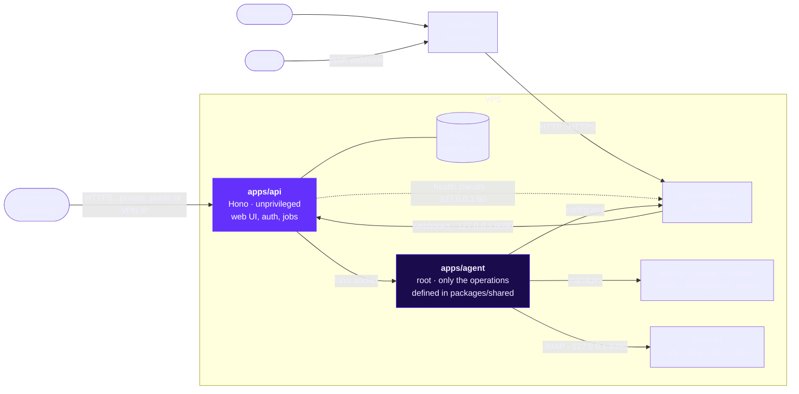

<p align="center">
  <picture>
    <source media="(prefers-color-scheme: dark)" srcset="docs/logo-dark.svg">
    
  </picture>
</p>

<p align="center"><strong>Your servers, sites and deploys. Seen from above.</strong></p>

<p align="center">
  <a href="LICENSE"></a>
  <a href="#supported-systems"></a>
  
</p>

# EaglePanel

A lightweight control panel to manage hosting accounts on a single VPS running OpenLiteSpeed.

## Quick install

On a fresh [supported server](#supported-systems):

```bash
curl -fsSL https://eagle.agust.in | sudo bash
```

`eagle.agust.in` only redirects to `get.sh` in the [latest release](https://github.com/agustinglez/eaglepanel/releases/latest); the package itself comes from GitHub. The installer asks whether your sites are behind Cloudflare and whether to install mail; to answer beforehand, pass the options after `-s --`, such as `| sudo bash -s -- --firewall cloudflare --no-mail`. The script downloads the latest release, checks its SHA256 and runs the installer, which shows its plan before changing anything, asks how the panel will be reached and, at the end, prints the panel address and the admin password (only once).

To update, use **Update now** under Updates in the panel, or on the server (the choices are saved; `eagle upgrade --check` only tells whether there is a newer release):

```bash
sudo eagle upgrade
```

<details>
<summary>Without piping a script into bash</summary>

```bash
curl -fLO https://github.com/agustinglez/eaglepanel/releases/latest/download/eaglepanel.tar.gz
curl -fLO https://github.com/agustinglez/eaglepanel/releases/latest/download/eaglepanel.tar.gz.sha256
sha256sum -c eaglepanel.tar.gz.sha256
tar -xzf eaglepanel.tar.gz && cd eaglepanel
sudo bash deploy/install.sh --firewall cloudflare
```

</details>

More options in [Installer options and updates](#installer-options-and-updates).

## Supported systems

The server where EaglePanel is installed:

| OS | Versions | Architectures |
|---|---|---|
| Ubuntu | 24.04, 26.04 | amd64, arm64 |
| Debian | 12, 13 | amd64, arm64 |

## Features

- **Accounts** with disk quotas, suspension (sites answer 503, services stop, FTP and MySQL are blocked, nothing is deleted) and per-account limits.
- **Environments**: domains and subdomains, each in its own `sites/<domain>` directory, with their own PHP version and options, logs and `.htaccess` (picked up a few seconds after it changes, without restarting by hand).
- **App deployments** from Git in Podman containers: static sites or server apps, push-to-deploy webhooks, release history and one-click rollback.
- **Certificates**: Cloudflare Origin CA, with optional Authenticated Origin Pulls.
- **FTP** (FTPS): a general access per account and, optionally, one per environment that only sees its directory.
- **Mail** (optional) with [Stalwart](https://stalw.art), one instance per server: per domain, mailboxes with their own space and aliases, forwarders (also to outside addresses), catch-all, DKIM keys generated by the server and the DNS records to add at any provider, checked against public DNS. Each domain uses its own `mail.<domain>`, with a Let's Encrypt certificate the panel requests and renews by itself once that name points to the server. Webmail ([Roundcube](https://roundcube.net)) at `webmail.<domain>`, over HTTPS with the domain's own certificate when it covers that name (a wildcard does); users sign in with the full address or just the part before the @. Mail from the previous server comes in from the domain page: from a cPanel backup uploaded to the account (only that domain's mail is extracted; new mailboxes keep their cPanel password and quota), or by IMAP from the old server into a mailbox; running it again does not duplicate messages. **Settings › Server mail** shows the server's own mail name, its records, its reverse DNS, whether the provider blocks outgoing port 25, and its certificate.
- **MySQL** databases with a built-in explorer: tables, structure, rows, SQL console, row editing, table forms, processes, export and import.
- **Redis and Memcached** per account.
- **File manager** with uploads.
- **Encrypted backups** with restic, scheduled daily.
- **Overview**: CPU and memory history (last hour, day or week), live health of every environment, latest jobs and a real "all systems healthy" status.
- **Jobs with rollback**: every change runs as a job with steps; if one fails, the previous steps are undone.
- **Two-factor authentication** (TOTP) for the administrator.

## Security

- The web UI and the API run as an unprivileged user. Only `apps/agent` runs as root, and it only accepts the operations defined in `packages/shared`: it never runs arbitrary commands.
- The database explorer never runs SQL written in the browser: values go as parameters and table or column names are checked against `information_schema`. The SQL console, row editing and table forms, as well as imports, run as a temporary MySQL user with privileges on that database only (read-only for a suspended account, read-and-delete for one over its limit), objects are reassigned to the database user, and a copy taken first puts the database back if the import fails.
- The panel is served over HTTPS on the address chosen at install time (private, public or VPN IP), with a strict Content Security Policy: every script, style and font is served by the panel itself.

## Architecture



- `apps/web`: React, Vite and shadcn/ui.
- `apps/api`: authentication, SQLite (Drizzle), jobs with rollback, the CPU and memory history and the environment health checks.
- `apps/agent`: the only privileged part. It never runs arbitrary commands.
- `packages/shared`: validators, the API-agent protocol and translations.
- `deploy/`: the unified installer (`install.sh`), the one-line installer (`get.sh`), the `eagle` server command, the systemd units and the packaging script (`package.sh`).

The installer asks how the panel will be reached and generates a self-signed certificate. To change it later, on the server: `eagle net` (menu) or `eagle net status`.

### Overview data

- **CPU and memory history**: the API samples the host every 15 s and keeps the history in `/var/lib/eaglepanel/metrics.json`, next to the database: raw samples for the last 24 h and 5-minute averages for the last 7 days. `GET /api/system/metrics?range=1h|24h|7d`.
- **Environment health**: every environment is checked against OpenLiteSpeed on `127.0.0.1:80` by its name, at most once a minute. An environment is `down` when it does not answer, answers 5xx, or its app failed; `inactive` when its app is stopped or was never deployed. Environments with a certificate answer a redirect to HTTPS there, so the check confirms OLS serves them, not the app behind. `GET /api/environments/health`.
- **System status**: "All systems healthy" is shown only when the agent answers, no environment is down, CPU and memory are under 90 % and no job failed in the last 24 h.

## Installer options and updates

Release packages are built by GitHub Actions with a signed provenance attestation. To check it with the [GitHub CLI](https://cli.github.com):

```bash
gh attestation verify eaglepanel.tar.gz --repo agustinglez/eaglepanel
```

To build the package yourself instead (it runs the tests first; the result is in `dist-deploy/`):

```bash
bash deploy/package.sh
```

`--firewall cloudflare` allows ports 80 and 443 from Cloudflare ranges only; `--firewall open`, from any source. On a first installation with a terminal it is asked; the choice is saved.

Mail is optional: a first installation with a terminal asks whether to install it (about 150 MB of RAM), and without one it is left out (`--mail` installs it). Later, on the server: `eagle mail on [mail.yourdomain.com]`, `eagle mail off` (stops it and closes its ports; mailboxes and data are kept) or `eagle mail status`. With mail, its ports (25, 465, 587 and 993) are open to any source with either firewall choice: mail cannot go through Cloudflare.

The server greets other mail servers with `hostname -f`. If that is not the name its IP's reverse DNS (PTR) points to, set it with `--mail-hostname mail.yourserver.com` or later in Settings › Server mail; it is saved too. If the server has a global IPv6, mail to other servers can leave over it: that name then needs an AAAA record too, and the IPv6 its own reverse DNS pointing to the same name. Settings › Server mail asks for both. Websites also answer over IPv6 when the server has it. Certificates for mail names are validated over port 80: with `--firewall cloudflare`, only for the length of the validation, traffic to port 80 that does not come from Cloudflare goes to the validation server and nowhere else.

Before changing anything, the installer shows its plan: what is already on the server and what it will install or change. What already existed (a running MySQL, an active ufw, vsftpd with its own configuration, `/etc/fstab`) is listed with the exact changes. On a first installation with a terminal, each of those is confirmed: apply it, or print the steps to do it by hand and stop without changing anything. The next run detects what was done by hand and leaves it alone. `--yes` applies everything without asking, and so does a run without a terminal. To see the plan only:

```bash
bash deploy/install.sh --plan --firewall cloudflare
```

To update, run the installer from a new package. The installer can be run as many times as needed: it only changes what is missing, backs up every file it touches to `/var/backups/eaglepanel-installer` and, if the new panel does not start, rolls back to the previous version and its database. On the first run it shows the admin password once, outside the log (`/var/log/eaglepanel-install.log`).

To check a server without changing anything:

```bash
bash deploy/install.sh --check
```

### Update notifications

The panel shows a notice when a newer version is published. Every 6 hours the API compares the installed version (the `VERSION` file that `deploy/package.sh` writes, such as `0.2.0`) with the latest release of this repository. The notice links to the release; to install it, run `sudo eagle upgrade` on the server. It downloads the release from the same repository, checks its SHA256 and runs its installer. `eagle upgrade --version 0.2.0` installs a specific release, and `--force` reinstalls it or goes back to an older one. When the release's installer is the same one that last completed on the server, only the panel is replaced (a few seconds); when it changed, every step runs as on a first installation. `eagle upgrade --full` always runs every step.

To check another source on a server, set it in `/etc/eaglepanel/update.env` and run `systemctl restart eaglepanel-api`:

```bash
EAGLEPANEL_UPDATE_REPO=your-user/eaglepanel
# or, instead, any HTTPS URL that returns { "version", "url", "notes", "publishedAt" }:
EAGLEPANEL_UPDATE_URL=https://example.com/eaglepanel/latest.json
```

### Versions and releases

EaglePanel follows [Semantic Versioning](https://semver.org): `MAJOR.MINOR.PATCH`. While the version is `0.x`, a minor version can include changes that need attention when updating; the release notes say so.

To publish a release, set `version` in `package.json`, commit it and push a tag with the same version. The release workflow checks that both match, runs the tests, builds the package, attests it and publishes it:

```bash
git tag v0.2.0 && git push origin v0.2.0
```

A version with a hyphen (`v1.0.0-rc.1`) is published as a pre-release: installations do not offer it as an update. A package built with `deploy/package.sh` outside a release carries the build time (`0.2.0+202611162215`): it is the same version for update notices, but the installer still updates the panel.

## Languages

All text in the code is in English, the default language. Translations live in `packages/shared/src/i18n`, gettext style: the key is the English text.

- `es/web.ts`: interface texts. In components, use `t("…")` from `react-i18next`.
- `es/server.ts`: messages sent by the API or the agent (errors, jobs, steps). They always arrive in English and the web UI translates them for display with `serverText(…)`, even when they carry values (`Deploy {{fqdn}}`).
- `en.ts`: English plural forms only.

Only English is enabled for now. To enable a language, add its code to `ENABLED_LOCALES` in `packages/shared/src/i18n/index.ts`; the user picks it in the interface and the choice is kept in the browser.

## Development

Requires [Bun](https://bun.sh). In sandbox mode, the agent records commands in `apps/agent/.sandbox/commands.log` without running them.

```bash
bun install
```

```bash
cp .env.example .env
```

Create the admin. The password is read from stdin and must be at least 12 characters long:

```bash
printf '%s' 'a-long-password' | bun run admin:set -- admin
```

Start everything (web UI at http://localhost:5173):

```bash
bun run dev
```

Checks:

```bash
bun test
```

```bash
bun run typecheck
```

After changing `apps/api/src/db/schema.ts`, generate the migration from `apps/api`:

```bash
bun run db:generate
```

## License

[GNU Affero General Public License v3.0](LICENSE) or later. You can use, study, modify and share EaglePanel. If you distribute a modified version, or let others use one over a network (for example, offering it to hosting customers), you must make its source code available to them under the same license.

Fonts: Inter, Exo 2 and JetBrains Mono, under the SIL Open Font License 1.1 (license files next to each font).
